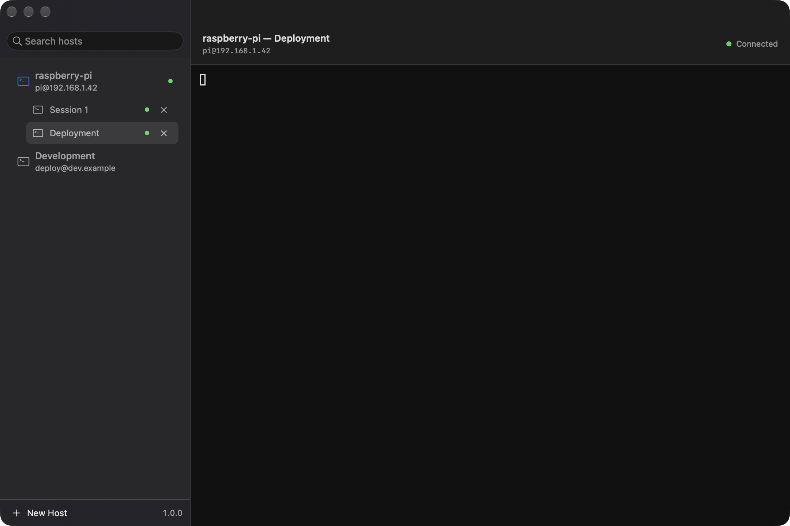

[](docs/images/maine-icon.png)

# Maine

[](https://www.apple.com/macos/sonoma/)
[](https://www.swift.org/)
[](https://www.openssh.com/)

**Save a host, open it, get a real terminal. No accounts, no telemetry — and sync is a server you host.**

Maine is a small, local-first SSH client for macOS. It keeps hosts and passwords together in one master-password-encrypted file, opens sessions by running the system `ssh` client you already trust, and reconnects your sessions automatically after unlock. There is no cloud of ours and no telemetry: sync is optional, self-hosted, and the server only ever sees encrypted bytes.

[Install](#install) · [Quick start](#quickstart) · [What's in the vault](#whats-in-the-vault) · [Build from source](#build-and-develop)

[](docs/images/maine-macos.png)

## Install

Download `Maine-X.Y.Z.dmg` from [GitHub Releases](https://github.com/qarasky/maine/releases), open it and drag **Maine** onto **Applications**. Releases are ad-hoc signed and not notarized (there is no Developer ID, by design), so the first launch of a downloaded copy may be blocked: right-click **Maine** in Finder and choose **Open**, or run `xattr -dr com.apple.quarantine /Applications/Maine.app`. macOS remembers the choice.

Maine updates itself. It checks once when the vault unlocks and then every two hours while it is unlocked, and **Maine → Check for Updates…** checks on demand. A newer release brings a popup with **Update**, **Later** and **Skip This Version**; **Update** downloads the disk image, verifies its published SHA-256, replaces the app and relaunches. The check is one request to GitHub's public Releases API with no identifiers, and **Settings → Updates** turns it off. Integrity means HTTPS plus SHA-256 from the same release, not proof of authorship. [docs/releasing.md](docs/releasing.md) covers how releases are cut and verified.

## Why

Maine is the shortest path between "I have a server" and "I am logged in". It is not a terminal emulator with a host manager bolted on, and it is not a cloud dashboard. Click a host, get a full terminal emulator with keyboard input, resizing and `Ctrl`/`Esc` sequences, rendered with [SwiftTerm](https://github.com/migueldeicaza/SwiftTerm). Right-click a host with a live session and choose **New Session** for another independent connection; sessions appear as indented rows beneath their host, each with its own close control. Hover a host and click its copy button (next to the close control), right-click it, or use **Host → Copy Credentials** to copy its details as a plain-text block — `IP:`, `username:`, and the saved `password:` when the vault is unlocked, plus `port:` when it is not 22 — ready to paste into a setup note or a chat. The copied block stays on the clipboard until something else replaces it.

## Quickstart

1. **Install the app** ([from Releases](#install)) or [build it from source](#build-and-develop). On first launch, create the password vault with a master password of at least 12 characters. Maine asks for it on every launch; canceling leaves passwords locked. Closing the window does not quit: Maine stays in the Dock and the menu bar. Clicking the Dock icon or left-clicking the menu bar item reopens the window; a right-click on the menu bar item offers Open Maine, Lock or Unlock, Quit, and Stop All Agents while agents are active.
2. **Add a host.** Click **New Host** (or press ⌘N) and fill in a name and a hostname or IP. Port, username and password are optional: leave the port blank for `22` and the username blank to let OpenSSH decide from `~/.ssh/config`, your key or the local user, and leave the password empty for key login through `~/.ssh` and `ssh-agent`. Maine types a saved password when the server asks; clearing the field removes it. Passwords cannot be edited or saved while the vault is locked.
3. **Connect.** Click a host in the sidebar to connect immediately. There is no intermediate host-details page.
4. **Work.** Click the sidebar session's **×** (or press ⇧⌘W) to close it and disconnect. The saved host stays in the list. Double-click a session name to rename it in place (Return saves, Escape cancels).
5. **Come back.** Quit and reopen Maine, then unlock the vault. Sessions return with their names and history, and reconnect automatically with history kept as scrollback. Switching sessions happens entirely in the sidebar.

Keyboard shortcuts: ⌘N new host, ⌘F search hosts, ⌘⏎ connect the selected host, ⇧⌘R reconnect, ⇧⌘W close a session and disconnect, ⌘W close the window and keep running in the menu bar.

## Why not just SSH?

Plain `ssh` is great if you live in a terminal. Maine is for everything around it: saved hosts whose passwords are supplied automatically (or that have no password at all, so your keys and `ssh-agent` do the work), multiple named sessions per host with scrollback that survives restarts, and click-to-connect without retyping addresses. The connection itself is still your `ssh`, so `ProxyJump`, `Match`, `IdentityFile`, `ForwardAgent`, certificates and hardware keys behave exactly as they do in a terminal.

## Why not another SSH client?

Maine has no accounts, no telemetry and no service of ours — nothing to sign up for and nothing that phones home. Optional sync runs on a server you host yourself. It never hides what it runs: the connection header shows the endpoint, and its tooltip shows the exact `ssh` command line. Hosts and passwords live in one portable encrypted file; session snapshots sit in a second encrypted file beside it that never leaves the Mac.

## What's in the vault

**`~/Library/Application Support/Maine/passwords.maine` is the single active vault**, written with `0600` permissions. It encrypts host names, addresses, ports, usernames, IDs and passwords together in an authenticated AES-256-GCM payload. A master password derives the encryption key with PBKDF2-SHA256 (600,000 iterations and a random salt). The unlock key lives in Keychain only for the current app session, for use by the SSH helper. It is removed on quit and reset on launch, so quitting always requires the master password again; closing the window while Maine runs in the menu bar does not. **Host → Lock Password Vault** and the menu bar's right-click menu remove it on demand. Locking does not disconnect already-open sessions. A host may have no saved password: Maine then runs plain `ssh`, so keys in `~/.ssh`, `ssh-agent` and `~/.ssh/config` authenticate, and any prompt appears in the terminal. Maine stores no private keys.

To share or move hosts and passwords, choose **Host → Show Encrypted Vault** and copy **only `passwords.maine`**. Quit Maine on the receiving Mac, back up its existing files, then place the copy in its Maine Application Support directory. Open Maine and choose **Host → Unlock Password Vault**. Send the master password separately, not alongside the files. Host IDs must remain unchanged, and sharing the vault grants access to all passwords in that file. This is file sharing, not automatic sync or merging. A forgotten master password cannot be recovered on another Mac.

On the first successful unlock, old `hosts.json` and version-1 passwords migrate into the unified vault. Malformed input and wrong passwords never overwrite it. For recovery, the original `hosts.json` and `passwords.maine.v1-backup` are retained and are no longer used after migration. **The old `hosts.json` is still plaintext:** after verifying your migrated data, remove or securely archive it yourself.

## Sync (optional, self-hosted)

Maine never talks to a server of ours. If you want the same vault on several machines, run the small Rust sync server that ships in `apps/sync-server` and pair each device with one token:

```sh
cd apps/sync-server
cargo run --release        # listening on 127.0.0.1:8484, data in ./data
```

The first device creates a slot and receives a token like `maine-2F7K-9QX2-…`; every other device enters the same token and the vault's master password. The server stores the encrypted `passwords.maine` file byte for byte and never sees a hostname, a credential, a password or the token itself — only `SHA-256(token)`, sizes and timestamps. Writes are conditional, so a device that is behind gets a conflict copy instead of silently overwriting the other side, and the last 32 versions of each slot are kept for recovery. The wire contract is [docs/sync-protocol.md](docs/sync-protocol.md); the client-side checklist is [docs/sync-client.md](docs/sync-client.md).

**macOS implements the client:** **Maine → Settings… → Sync** creates or joins a slot, and from then on the vault pulls when it unlocks, pushes a couple of seconds after an edit, polls while it is open, and stops syncing when it locks. A pairing's token lives in the login Keychain, not in the vault, so it survives the vault being replaced by the server's copy. Conflicts never lose data: the losing side is kept as `passwords.conflict-….maine` next to the vault. Android does not speak the protocol yet.

[apps/sync-server/README.md](apps/sync-server/README.md) covers deployment: reverse-proxy TLS, systemd, Docker, and the `--create-secret` switch for servers that are reachable by strangers.

## Groups

Organise hosts into collapsible groups in the sidebar. **Host → New Group** (⇧⌘N), the folder button in the sidebar footer, or **Move to Group → New Group…** on a host's context menu creates one and starts renaming it. Click a group's header to collapse or expand it; right-click it to rename or delete it (deleting a group keeps its hosts, ungrouped).

Drag a host onto a group header to add it to the end of that group, onto another host to place it just above that host (in that host's group), or onto the strip at the bottom of the list to take it out of its group. Drag a group header onto another group header to reorder groups. **Move to Group** in a host's context menu and the **Group** picker in the host editor do the same without dragging. Ungrouped hosts stay at the top. While searching, groups with a match are shown expanded.

Groups and their order live in the vault, so they sync with your hosts. Which groups are collapsed is remembered per Mac, encrypted next to the saved sessions, and never synced. The Android client does not show groups yet, and saving a host there drops them.

## Agents (MCP)

Maine can let AI agents such as Claude Code or Claude Desktop work on your servers through real Maine sessions you can watch. It is off until you turn it on in **Settings → Agents**:

1. Switch on **Allow agent access**.
2. **Add Client…**, give it a name, and copy the setup it shows once — for Claude Code a command like `claude mcp add maine --env MAINE_AGENT_TOKEN=… -- "/Applications/Maine.app/Contents/MacOS/Maine" --mcp`, for Claude Desktop the JSON for `claude_desktop_config.json`.
3. Tick the groups and hosts agents may use. Everything else is invisible to them.

Agents can list the allowed hosts and their own sessions, open sessions, run commands (getting output and the exit code), read output and the screen, send keys, ask Maine to type a host's saved password into a password prompt, and close their sessions. `type_password` fires only when the last screen line is a password prompt (sudo, ssh, su): Maine types the saved password plus Return, never returns it, and masks it in later output.

Agent sessions appear under their host in the sidebar with an agent badge; the header shows who drives it with **Pause**, **Stop** and **Keep Session**, and the menu bar item has **Stop All Agents**. Sessions an agent opened are not saved or restored unless you keep them, and locking the vault pauses every agent. Right-click one of your own sessions and choose **Hand to Agent → client** to let an agent drive it instead. Hand-off needs agent access on, the vault unlocked, the host allowed, a paired client, and the shell idle at a prompt, because the first command is typed into it; the session stays yours, keeps its scrollback, is still saved and restored, and returns to you when the agent stops.

What leaves your Mac, only for allowed hosts: host names, groups, addresses, ports, usernames and the terminal output of agent sessions, sent to the agent and its model provider. Saved passwords are never sent; one is typed locally into a detected prompt only when the agent asks. There are no approval prompts in Maine — allowed means fully usable — because agents already ask for permission in their own harnesses. Access rules, client tokens and the activity log stay on this Mac and never sync. Revoke a client in Settings to cut it off immediately.

**Settings → Agents → Activity** lists what agents did on this Mac: sessions opened, handed over and closed, commands with their exit codes, keys sent, and each time a saved password was typed. It keeps the newest 1,000 entries in the encrypted device-local file and shows the latest 100. It never records saved passwords, terminal output or the literal text sent with `send_keys` (only its length), is empty while the vault is locked, and has a **Clear…** button. The design is [docs/mcp.md](docs/mcp.md).

## Saved sessions

Sessions automatically save their name and the terminal's currently retained plain-text buffer (up to 1 MiB), periodically and before normal quit or vault lock. It is a snapshot, not a full activity log: colors, cursor state, remote processes and shell state are not saved. Output can contain sensitive data, so snapshots are encrypted with the vault's key. They stay on this Mac: snapshots live in their own file, `sessions-<vault id>.maine`, next to `passwords.maine`, and are never part of the synced vault. Another device sees your hosts but not your sessions or their scrollback, and session checkpoints never trigger a sync push. Vaults written by older builds, which kept snapshots inside `passwords.maine`, move them to the local file on the next unlock.

Renaming updates the persisted name immediately. Normal quit keeps session records; only explicit **Close Session**, **×**, **Close Every Session**, or deleting the host removes them. While the vault is locked, autosave pauses; closing persisted sessions requires unlocking so their records can actually be removed. Quitting while locked retains the last checkpoint.

## Design

The desktop layout follows [documented Mac design references](docs/macos-design.md): native search, compact sidebar rows, consistent terminal insets and an understated connection status. The app icon is the M monogram in `apps/macos/Resources/AppIcon.icns`; see [Build and develop](#build-and-develop) for regenerating it.

## Debugging a disappearing window or terminal

1. Quit Maine and reopen `apps/macos/build/Maine.app` after rebuilding. The app must have a **Debug** menu; an older running copy does not have these probes.
2. Choose **Debug → Enable Debug Logging**, then reproduce the problem.
3. Leave the window as it is and choose **Debug → Capture Diagnostic Snapshot** (⌥⇧⌘L).
4. Choose **Debug → Show Debug Logs**. Logs are local JSON-lines files at `~/Library/Logs/Maine/debug.jsonl`, with one rotated `debug.previous.jsonl`. Keep both when reporting the issue, and disable logging after reproducing it.

Disconnect automatically captures the window/view tree before termination and again after 100 ms, 500 ms and 2 seconds. The log does **not** capture passwords, hostnames, usernames, commands, environment variables, terminal contents, keystrokes or screenshots. It does include host and session UUIDs and the app executable path. Files are `0600`; rotation retains approximately 5 MB each for the current and previous log. Nothing is uploaded. Logging also works in release builds — run `apps/macos/build/Maine.app/Contents/MacOS/Maine --debug` to see native runtime warnings too.

## Build and develop

Requirements: macOS 14 (Sonoma) or later, Xcode 16 or later selected with `xcode-select` (SwiftUI's macros ship with Xcode, so the Command Line Tools alone are not enough), and the system OpenSSH client at `/usr/bin/ssh`.

```sh
cd apps/macos
scripts/build-app.sh --release --run
scripts/build-app.sh --release --version 1.2.3   # stamp a version into the bundle
scripts/make-dmg.sh 1.2.3                        # build/Maine-1.2.3.dmg + .dmg.sha256
```

The script compiles the package, wraps the binary in `Maine.app` with its `Info.plist` and `AppIcon.icns`, ad-hoc signs it, and (with `--run`) launches it. The app ends up at `apps/macos/build/Maine.app`; `open build/Maine.app` starts it again later. A build without `--version` reports `0.0.0-dev`, which never auto-checks for updates. Releases are cut by pushing a `vX.Y.Z` tag; [docs/releasing.md](docs/releasing.md) has the flow and the Gatekeeper caveat. If `xcode-select -p` prints `/Library/Developer/CommandLineTools`, point it at Xcode once: `sudo xcode-select --switch /Applications/Xcode.app/Contents/Developer`.

For a fast edit-build-run loop, or to see logging in a terminal:

```sh
cd apps/macos
swift build          # debug build
scripts/build-app.sh --debug --run
swift run Maine      # runs the debug executable directly
```

Tests:

```sh
cd apps/macos
swift test                     # everything that does not open a window
MAINE_UI_TESTS=1 swift test    # plus the window/layout tests (they take over the screen; CI always runs them)
```

The suite covers the configuration format, host validation, file persistence and permissions, the exact `ssh` command lines Maine builds, the `~/.ssh/config` reader, the PTY session lifecycle (start, output, exit, disconnect) using a real child process, and the agent tools, activity log and OSC 133 parser. `packages/schema` has its own checks, which need nothing but Python 3:

```sh
cd packages/schema
python3 tools/validate.py
```

The sync server is a Rust crate with its own suite — unit tests plus HTTP integration tests against a real server on a loopback port — and a curl smoke test of the whole protocol:

```sh
cd apps/sync-server
cargo test
scripts/smoke.sh
```

The macOS client has a sync suite that runs against the real server after `cargo build --release` in `apps/sync-server`; point `MAINE_SYNC_SERVER_BIN` at the binary:

```sh
cd apps/macos
MAINE_SYNC_SERVER_BIN="$PWD/../sync-server/target/release/maine-sync-server" \
    swift test --filter SyncServerIntegrationTests
```

GitHub Actions runs all of this on every push to `main` and every pull request — the schema validator, `swift test` (including the macOS sync client integration suite against the built server), the Android JVM unit tests, and the sync server's Rust tests, lint and formatting (see `.github/workflows/ci.yml`).

Repository layout:

```
maine/
├── apps/
│   ├── macos/              Swift + SwiftUI application
│   ├── android/            Kotlin + Compose application (vault parity, real terminal)
│   └── sync-server/        Rust sync server (zero-knowledge vault slots)
├── packages/
│   └── schema/           Versioned JSON configuration format + validator
├── docs/                 architecture.md, macos-design.md, mcp.md, releasing.md, sync-protocol.md, sync-client.md, images/
└── README.md
```

The directory for Linux is added when that client is built, not before. The shared contract between clients is the configuration format, not shared code: see [`packages/schema/README.md`](packages/schema/README.md). The encrypted vault envelope is additionally implemented byte-for-byte on every client, so a `passwords.maine` file copied between machines unlocks with the same master password (proven by `vault-golden-v2.json`, generated by Swift, in the Android tests).

Regenerate the M monogram icon with `swift scripts/render-mark.swift monogram <master.png>`, then rebuild the `.iconset`/`.icns` with `sips` + `iconutil` as documented in that script's header. `scripts/render-icon.swift` (the `>_` prompt mark) is kept for possible future use.

## Status

The macOS application is the first client. Releases are tagged `vX.Y.Z` and published by CI as a DMG with a checksum:

| | |
| --- | --- |
| Save, edit, delete, duplicate hosts | done |
| Versioned JSON storage | done |
| Interactive SSH session over a PTY | done |
| Multiple sessions, sidebar switching/closing, reconnect | done |
| Error reporting for failed connections | done |
| Unified encrypted hosts/password vault | done |
| Saved passwords, portable encrypted vault, master-password unlock | done |
| Key-based hosts (no saved password; uses `~/.ssh` keys and ssh-agent) | done |
| Android client (vault parity, host CRUD, real terminal) | in progress |
| Self-hosted sync server (Rust, zero-knowledge slots) | done |
| Sync in the macOS client (create/join, conflict copies, workspaces) | done |
| MCP agent access (sessions, run, output, keys) | done |
| Agents typing saved passwords into password prompts | done |
| MCP activity log, OSC 133 completion | done |
| "Hand to Agent" for human-opened sessions | done |
| DMG releases from tags, in-app update with SHA-256 check | done |
| Sync in the Android client | not started |
| Linux client | not started |
| Accounts, hosted service, key management | not planned |

## License

Maine depends on [SwiftTerm](https://github.com/migueldeicaza/SwiftTerm) (MIT). No license has been chosen for Maine itself yet.
