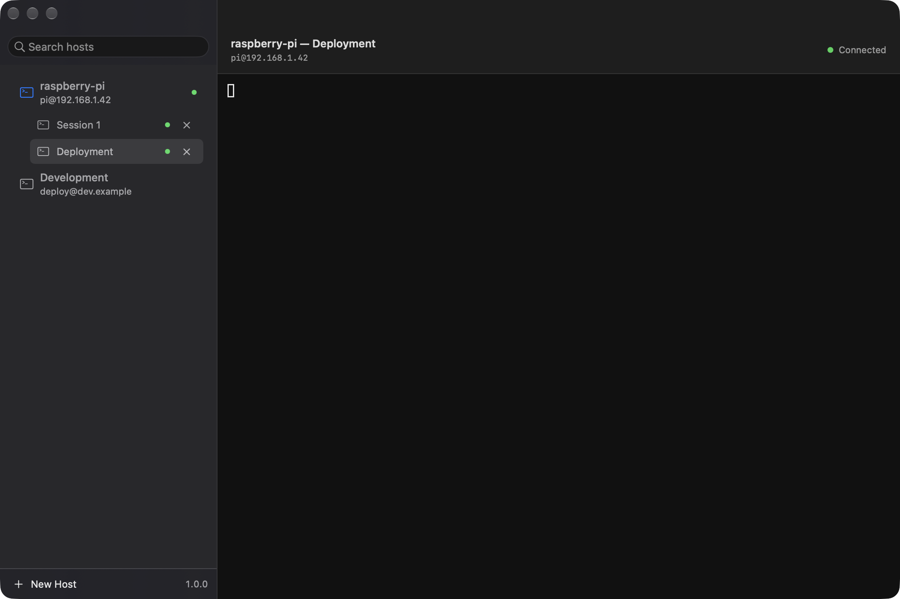

[](docs/images/maine-icon.png)

# Maine

[](https://www.apple.com/macos/sonoma/)
[](https://www.swift.org/)
[](https://www.openssh.com/)

**Save a host, open it, get a real terminal. No accounts, no cloud, no telemetry.**

Maine is a small, local-first SSH client for macOS. It keeps hosts and passwords together in one master-password-encrypted file, opens sessions by running the system `ssh` client you already trust, and reconnects your sessions automatically after unlock. There is no backend, no sync, and no telemetry.

[Quick start](#quickstart) · [What's in the vault](#whats-in-the-vault) · [Build from source](#build-and-develop)

[](docs/images/maine-macos.png)

## Why

Maine is the shortest path between "I have a server" and "I am logged in". It is not a terminal emulator with a host manager bolted on, and it is not a cloud dashboard. Click a host, get a full terminal emulator with keyboard input, resizing and `Ctrl`/`Esc` sequences, rendered with [SwiftTerm](https://github.com/migueldeicaza/SwiftTerm). Right-click a host with a live session and choose **New Session** for another independent connection; sessions appear as indented rows beneath their host, each with its own close control.

## Quickstart

1. **Build and open the app** ([from source](#build-and-develop)). On first launch, create the password vault with a master password of at least 12 characters. Maine asks for it on every launch; canceling leaves passwords locked.
2. **Add a host.** Click **New Host** (or press ⌘N) and fill in a name, a hostname or IP, and a password. Port and username are optional — leave them at `22` and blank to let OpenSSH decide from `~/.ssh/config`. Passwords cannot be edited or saved while the vault is locked.
3. **Connect.** Click a host in the sidebar to connect immediately. There is no intermediate host-details page.
4. **Work.** Click the sidebar session's **×** (or press ⇧⌘W) to close it and disconnect. The saved host stays in the list. Double-click a session name to rename it in place (Return saves, Escape cancels).
5. **Come back.** Quit and reopen Maine, then unlock the vault. Sessions return with their names and history, and reconnect automatically with history kept as scrollback. Switching sessions happens entirely in the sidebar.

Keyboard shortcuts: ⌘N new host, ⌘F search hosts, ⌘⏎ connect the selected host, ⇧⌘R reconnect, ⇧⌘W close a session and disconnect, ⌘W close the window.

## Why not just SSH?

Plain `ssh` is great if you live in a terminal. Maine is for everything around it: saved hosts with passwords supplied automatically, multiple named sessions per host with scrollback that survives restarts, and click-to-connect without retyping addresses. The connection itself is still your `ssh`, so `ProxyJump`, `Match`, `IdentityFile`, `ForwardAgent`, certificates and hardware keys behave exactly as they do in a terminal.

## Why not another SSH client?

Maine has no accounts, no cloud, no sync and no telemetry — there is nothing to sign up for and nothing that phones home. It never hides what it runs: the connection header shows the endpoint, and its tooltip shows the exact `ssh` command line. Hosts, passwords and session snapshots live in one portable encrypted file, not a proprietary sync service.

## What's in the vault

**`~/Library/Application Support/Maine/passwords.maine` is the single active vault**, written with `0600` permissions. It encrypts host names, addresses, ports, usernames, IDs and passwords together in an authenticated AES-256-GCM payload. A master password derives the encryption key with PBKDF2-SHA256 (600,000 iterations and a random salt). The unlock key lives in Keychain only for the current app session, for use by the SSH helper. It is removed on quit and reset on launch; **Host → Lock Password Vault** also removes it. Locking does not disconnect already-open sessions.

To share or move hosts and passwords, choose **Host → Show Encrypted Vault** and copy **only `passwords.maine`**. Quit Maine on the receiving Mac, back up its existing files, then place the copy in its Maine Application Support directory. Open Maine and choose **Host → Unlock Password Vault**. Send the master password separately, not alongside the files. Host IDs must remain unchanged, and sharing the vault grants access to all passwords in that file. This is file sharing, not automatic sync or merging. A forgotten master password cannot be recovered on another Mac.

On the first successful unlock, old `hosts.json` and version-1 passwords migrate into the unified vault. Malformed input and wrong passwords never overwrite it. For recovery, the original `hosts.json` and `passwords.maine.v1-backup` are retained and are no longer used after migration. **The old `hosts.json` is still plaintext:** after verifying your migrated data, remove or securely archive it yourself.

## Saved sessions

Sessions automatically save their name and the terminal's currently retained plain-text buffer (up to 1 MiB), periodically and before normal quit or vault lock. It is a snapshot, not a full activity log: colors, cursor state, remote processes and shell state are not saved. Output can contain sensitive data, so snapshots are encrypted along with hosts and passwords.

Renaming updates the persisted name immediately. Normal quit keeps session records; only explicit **Close Session**, **×**, **Close Every Session**, or deleting the host removes them. While the vault is locked, autosave pauses; closing persisted sessions requires unlocking so their records can actually be removed. Quitting while locked retains the last checkpoint.

## Design

The desktop layout follows [documented Mac design references](docs/macos-design.md): native search, compact sidebar rows, consistent terminal insets and an understated connection status. The app icon is the M monogram in `apps/macos/Resources/AppIcon.icns`; see [Build and develop](#build-and-develop) for regenerating it.

## Debugging a disappearing window or terminal

1. Quit Maine and reopen `apps/macos/build/Maine.app` after rebuilding. The app must have a **Debug** menu; an older running copy does not have these probes.
2. Choose **Debug → Enable Debug Logging**, then reproduce the problem.
3. Leave the window as it is and choose **Debug → Capture Diagnostic Snapshot** (⌥⇧⌘L).
4. Choose **Debug → Show Debug Logs**. Logs are local JSON-lines files at `~/Library/Logs/Maine/debug.jsonl`, with one rotated `debug.previous.jsonl`. Keep both when reporting the issue, and disable logging after reproducing it.

Disconnect automatically captures the window/view tree before termination and again after 100 ms, 500 ms and 2 seconds. The log does **not** capture passwords, hostnames, usernames, commands, environment variables, terminal contents, keystrokes or screenshots. It does include host and session UUIDs and the app executable path. Files are `0600`; rotation retains approximately 5 MB each for the current and previous log. Nothing is uploaded. Logging also works in release builds — run `apps/macos/build/Maine.app/Contents/MacOS/Maine --debug` to see native runtime warnings too.

## Build and develop

Requirements: macOS 14 (Sonoma) or later, Xcode 16 or later selected with `xcode-select` (SwiftUI's macros ship with Xcode, so the Command Line Tools alone are not enough), and the system OpenSSH client at `/usr/bin/ssh`.

```sh
cd apps/macos
scripts/build-app.sh --release --run
```

The script compiles the package, wraps the binary in `Maine.app` with its `Info.plist` and `AppIcon.icns`, ad-hoc signs it, and (with `--run`) launches it. The app ends up at `apps/macos/build/Maine.app`; `open build/Maine.app` starts it again later. If `xcode-select -p` prints `/Library/Developer/CommandLineTools`, point it at Xcode once: `sudo xcode-select --switch /Applications/Xcode.app/Contents/Developer`.

For a fast edit-build-run loop, or to see logging in a terminal:

```sh
cd apps/macos
swift build          # debug build
scripts/build-app.sh --debug --run
swift run Maine      # runs the debug executable directly
```

Tests:

```sh
cd apps/macos
swift test
```

The suite covers the configuration format, host validation, file persistence and permissions, the exact `ssh` command lines Maine builds, the `~/.ssh/config` reader, and the PTY session lifecycle (start, output, exit, disconnect) using a real child process. `packages/schema` has its own checks, which need nothing but Python 3:

```sh
cd packages/schema
python3 tools/validate.py
```

Repository layout:

```
maine/
├── apps/
│   └── macos/            Swift + SwiftUI application (the only client today)
├── packages/
│   └── schema/           Versioned JSON configuration format + validator
├── docs/                 architecture.md, macos-design.md, images/
└── README.md
```

Directories for Windows, Linux and Android are added when those clients are built, not before. The shared contract between clients is the configuration format, not shared code: see [`packages/schema/README.md`](packages/schema/README.md).

Regenerate the M monogram icon with `swift scripts/render-mark.swift monogram <master.png>`, then rebuild the `.iconset`/`.icns` with `sips` + `iconutil` as documented in that script's header. `scripts/render-icon.swift` (the `>_` prompt mark) is kept for possible future use.

## Status

The macOS application is the first client, and it is at version 1.0.0:

| | |
| --- | --- |
| Save, edit, delete, duplicate hosts | done |
| Versioned JSON storage | done |
| Interactive SSH session over a PTY | done |
| Multiple sessions, sidebar switching/closing, reconnect | done |
| Error reporting for failed connections | done |
| Unified encrypted hosts/password vault | done |
| Saved passwords, portable encrypted vault, master-password unlock | done |
| Windows, Linux, Android clients | not started |
| Sync, accounts, key management | not planned |

## License

Maine depends on [SwiftTerm](https://github.com/migueldeicaza/SwiftTerm) (MIT). No license has been chosen for Maine itself yet.
